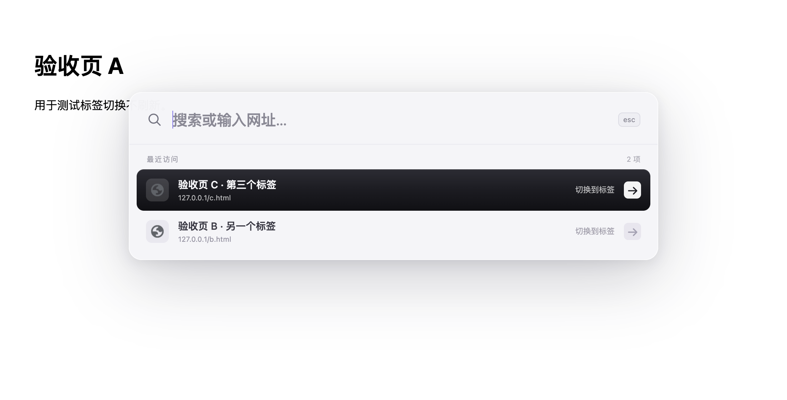
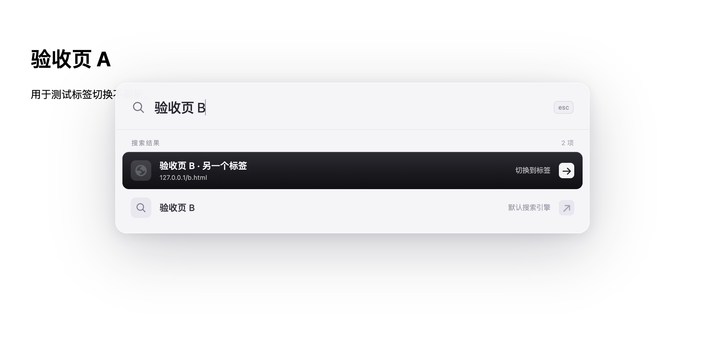
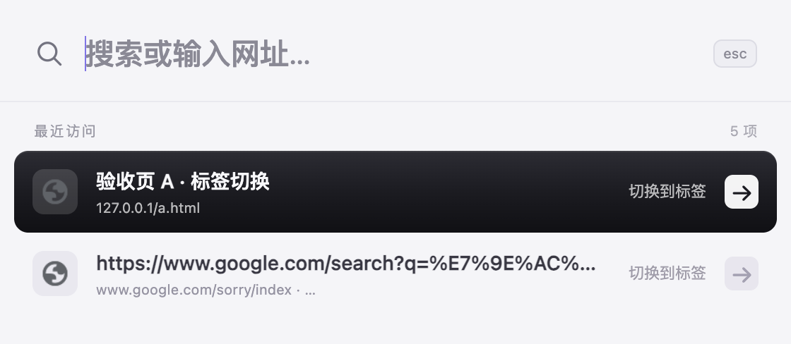
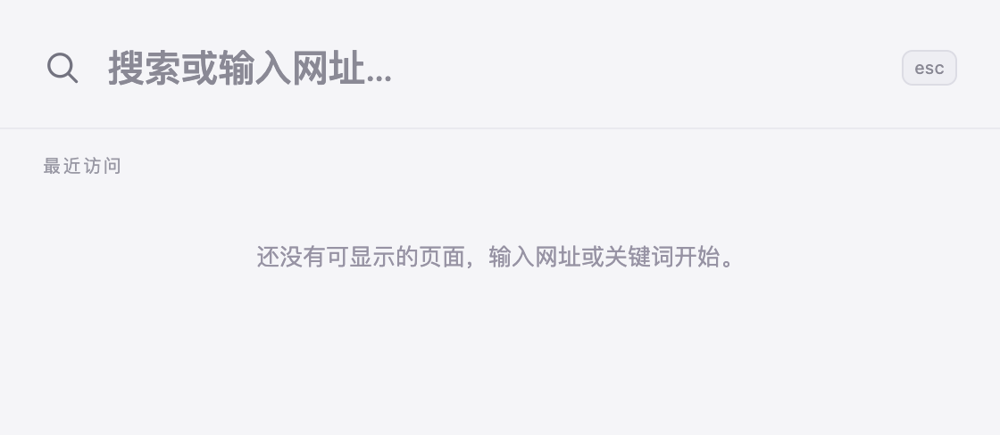

# 端到端验收记录（2026-11-10）

## 结论

README 的 9 项安装后验收清单，在**真实 Chrome 内核**中跑通了 8 项，第 9 项（原生 ⌘T）只能确认扩展没有占用该组合键，最终仍需一次人工按键。扩展以原样加载，manifest 未做任何修改。

| # | 清单项 | 结果 |
|---|---|---|
| 1 | ⌘E 打开浮层、可直接输入、Esc 关闭 | 通过 |
| 2 | 输入 example.com 回车，新标签打开 | 通过 |
| 3 | 再输入相同网址，切换原标签不新增 | 通过 |
| 4 | 输入已打开页面标题，切换且不刷新 | 通过 |
| 5 | 目标标签移到另一窗口后仍能切换 | 通过 |
| 6 | 普通文字回车使用默认搜索引擎 | 通过（重复运行会被 Google 人机验证拦截，此时脚本记为部分通过） |
| 7 | 中文组合输入时 Enter 不提前跳转 | 通过（合成组合事件） |
| 8 | Chrome 新标签页回退到工具栏弹窗 | 通过 |
| 9 | 原生 ⌘T 保留 | 部分（需人工按键） |

## 环境

- macOS，内核 `Chrome/156.0.8078.4`（本机 Playwright 缓存的 Chrome for Testing）。
- 独立临时 profile，位于系统临时目录，跑完即删除；未触碰日常 Chrome 配置、标签或历史。
- 扩展以 `--load-extension` 加载项目内的 `extension/`，扩展 ID `agbcahfnhkoekdpiacbnmgaalheoichh`。
- 测试页面由脚本内置的静态服务提供，端口随机。

## 为什么不是本机 Chrome 157

Chrome 137 起，正式版禁用了 `--load-extension`。实测本机 157：扩展页返回 `ERR_BLOCKED_BY_CLIENT`，`chrome://extensions` 列表为空（连 `--enable-unsafe-extension-debugging` 也无法绕过）。同一台机器上 Chrome for Testing 156 正常加载并启动 `worker.mjs`。两者内核与扩展 API 相同，差异不落在被测代码路径上。

## 触发方式与可信度

⌘E 通过 DevTools 协议注入 Cmd+E 按键事件，不是直接调用扩展内部函数。以下两点说明它走的是真实链路：

1. 注入后触发的是 Chrome 的扩展命令加速器（`chrome.commands.onCommand`），否则不会进入 `toggle()`。
2. 原版 manifest 只声明 `activeTab + scripting`，没有 `host_permissions`，而浮层仍然成功注入当前页面——说明 `activeTab` 是由键盘命令手势授予的。若走的是脚本直调，这一步会像早期试探中那样被 `Cannot access contents of url ... must request permission` 拒绝。

macOS 的 System Events 辅助功能权限对本进程被拒绝（错误 -10004），因此无法用 `osascript` 发送物理按键，也无法自动化 Chrome 原生快捷键。

## 关键证据

- `chrome.commands.getAll()` → `toggle-palette` 快捷键为 `⌘E`；工具栏徽标文本为空（说明注册成功，没有走到「快捷键未绑定」的 `!` 分支）。
- 第 1 项后 `document.querySelector('div[style*="2147483647"]')` 为空，页面注入节点已清除。
- 第 3 项标签数 4→4，当前标签为 `https://example.com/`，未新建。
- 第 4、5 项用页面内 `window.__loadMarker` 比对，切换前后标记一致 → 标签未被刷新。
- 第 6 项直达 `https://www.google.com/search?q=%E7%9E%AC%E6%90%9C%E9%AA%8C%E6%94%B6%E6%B5%8B%E8%AF%95...`；重复运行会被 Google 拦到 `sorry/index` 人机验证页，脚本会把该情况标为「部分通过」而不是「通过」。
- 仓库里的 `docs/e2e/results.json` 是 19:09 那次运行的产物，其中第 6 项正好被人机验证拦截，所以文件里记为「部分通过」；同一脚本在 19:04 的运行中该项直达结果页（`clean: true`）。文案以此记录为准，两者不矛盾。
- 第 8 项在 `chrome://newtab/` 上注入被拒后，`chrome.action.openPopup` 打开真实 `popup.html`，面板完整可用。

## 截图







## 界面调整后的复测（同日 19:40）

按使用反馈改了四处，并重跑同一套脚本，结果仍是 8 项通过、第 9 项待人工：

1. 去掉浮层背后的黑色遮罩（此前来自 `palette.js` 的 `dialog::backdrop`，透明度 0.28 加 2px 模糊），只保留面板自身阴影。
2. 去掉鼠标悬停时的「瞬搜搜索面板」系统浮字（iframe 的 `title` 属性改成 `aria-label`）。
3. 选中行由紫色改为接近黑色的渐变（`#2c2c34 → #1b1b21 → #101014`），箭头块改为白底深色图标。
4. 移除了 `_execute_action`：manifest 不再声明 `action`，快捷键页只剩「打开 / 关闭瞬搜面板」一条；受限页面改用居中的小面板窗口（560×420），不再依赖 `chrome.action.openPopup`。

备用面板已改为居中悬浮：实测窗口几何 560×332（高度贴合内容）、水平居中于宿主窗口、失去焦点后约 1 秒内自动关闭。



代价要说明白：**工具栏图标随之消失**，入口只剩快捷键。这是去掉那行配置的唯一方式——只要声明了 `action`，Chrome 就一定会自动生成 `_execute_action` 那一行，manifest 里无法单独隐藏。

## 仍未覆盖

- **原生 ⌘T**：CDP 与系统脚本都无法触发浏览器级原生快捷键，只能确认扩展命令表里没有 ⌘T 绑定。
- **真实中文输入法**：第 7 项用的是浏览器合成组合事件（`Input.imeSetComposition` 与合成 CompositionEvent），不等于用户自己的输入法。
- **favicon 实际加载**：截图里可见图标位，但未逐项核对真实站点图标。
- **service worker 被回收后再唤醒**：本次运行期间 SW 一直在，未覆盖长时暂停恢复。
- **用户日常配置**：未接触，其他扩展抢占 ⌘E、企业策略等情况未知。

## 复现

```sh
npm run e2e
```

脚本会自建静态服务、启动 Chrome for Testing、执行 9 项并截图，产物写入 `docs/e2e/`（`results.json` + PNG）。可用 `CHROME_PATH` 指定浏览器、`QS_ARTIFACTS` 指定产物目录。任一项目「未通过」时脚本以非 0 退出；「部分通过」不算失败。

脚本位置：`scripts/e2e-acceptance.mjs`。基线仍是 `npm test`（31/31）与 `npm run check`。
